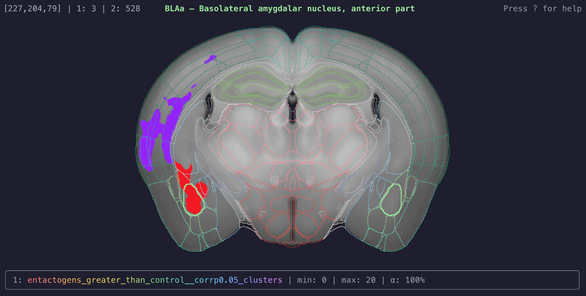
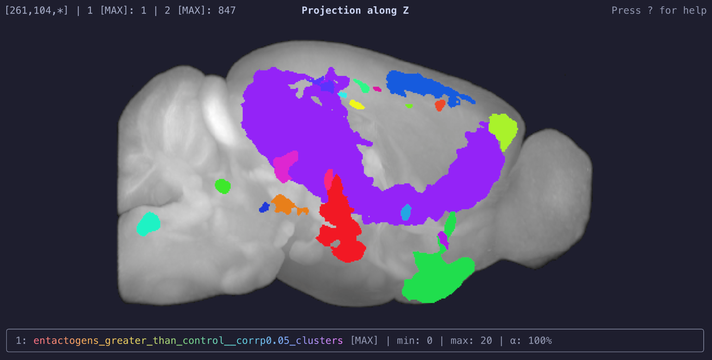
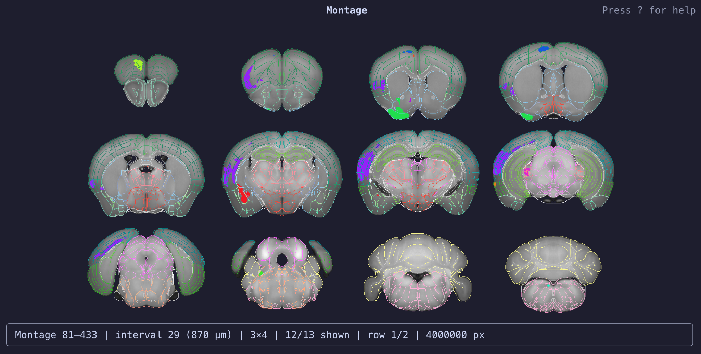
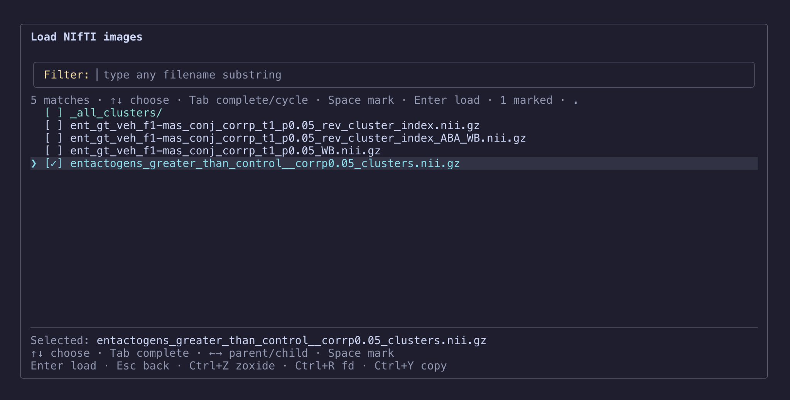

# niv

**A fast, keyboard-first NIfTI viewer for the terminal.**

`niv` is a Rust terminal UI for browsing `.nii` and `.nii.gz` volumes, combining aligned image layers, and inspecting anatomical atlas regions. It draws its image using the [Kitty graphics protocol](https://sw.kovidgoyal.net/kitty/graphics-protocol/) and is designed for local terminals such as Ghostty and remote workflows using Rex/SSH.



*Slice view — registered anatomical template, categorical cluster overlay, and colored CCFv3 atlas boundaries.*

> **Status:** Active development / experimental. Most use has been on macOS with Ghostty and Rex. Other Kitty-compatible terminals may work, but behavior depends on the terminal's graphics, mouse and keyboard support.

## Features

- **Responsive slice browsing** in the X, Y or Z array axis, with independent orientation settings and a keyboard, trackpad or wheel.
- **Multiple image layers** with reorder, hide/show, adjustable intensity windows, opacity, and grayscale, warm, cool, or deterministic categorical colors.
- **Anatomical atlas wireframes** from a solid label volume, with region names/IDs from an optional CSV lookup table (LUT), hover inspection, and color-coded contours.
- **Per-layer projections**: maximum, average, and minimum-positive projections; cached after first calculation.
- **Montage viewing** with configurable bounds, spacing, rows/columns, and resolution, intended for preparing figures.
- **File discovery** with a searchable image picker, recursive `fd` search, and optional `zoxide` directory navigation; optional paths pasted or dropped from the terminal.
- **Saved `.niv.toml` scenes** for restoring the image stack and many viewer settings.
- **24-bit RGB or 32-bit RGBA** output: opacity and threshold transparency work *between layers* in either mode; RGBA permits the terminal background to show through empty pixels.

`niv` does **not** currently perform registration or resampling. Image layers and atlas volumes must have the same voxel grid. Array axes are not automatically reoriented to anatomical world space.

## Screenshots

### Maximum-intensity projection



*Independent per-layer projections: an anatomical template with superimposed cluster labels. Projection results are cached so window and opacity adjustments do not require re-projecting the volume.*

### Montage



*Multi-slice montage with adjustable bounds, slice interval, grid layout, and rendering resolution.*

### Image picker



*Interactive NIfTI loading with substring filtering and multi-selection; recursive `fd` search and `zoxide` directory navigation are also available.*

These images are bundled as compressed, lossless WebP assets. Full-resolution screenshots and additional views can be added to the project documentation later.

## Requirements

- Rust and Cargo (Rust **1.85 or newer** per `Cargo.toml`; a newer stable toolchain is recommended).
- A terminal that supports the Kitty graphics protocol; Ghostty is the main development target.
- Optional: [`fd`](https://github.com/sharkdp/fd) for recursive file search and [`zoxide`](https://github.com/ajeetdsouza/zoxide) for ranked directory navigation.
- Optional: Rex for remote terminal sessions. `niv` does not link to Rex or libghostty.

## Installation

```bash
git clone https://github.com/b-heifets/niv.git
cd niv
cargo test
cargo install --path . --locked
niv -v
```

For a development checkout, use `cargo build --release` and run `./target/release/niv`. You can install that build with `cargo install --path .`. Commit `Cargo.lock` when publishing an executable application; `--locked` requires it.

## Quick start

```bash
niv image.nii.gz                              # single image, no atlas by default
niv template.nii.gz clusters.nii.gz -a         # cluster layer + configured atlas
niv -i image_1.nii.gz image_2.nii.gz           # multiple images
niv image.nii.gz -a -t                        # add configured atlas and template
niv -a                                       # configured atlas only
niv image.nii.gz -a /path/to/atlas.nii.gz --lut /path/to/regions.csv
niv image.nii.gz --background transparent
niv image.nii.gz --profile
niv --scene analysis.niv.toml
```

The first ordinary image is the reference grid. Loaded images appear in the **top-to-bottom** layer list, with the atlas drawn over all intensity layers. For a bare `-a` or `-t`, place the flag **after** image filenames so the next filename is not interpreted as its explicit argument. Quoted glob patterns can be supplied with `-i` and expanded by `niv`.

Press **`?`** inside the viewer for the complete, context-sensitive key reference. `niv -h` shows brief CLI help; `niv --help` documents options.

### Everyday shortcuts

| Key | Action |
| --- | --- |
| `↑` / `↓` or `j` / `k`, mouse wheel | Browse slices |
| `x`, `c`/`y`, `z` | Switch array axis; repeat to flip horizontally |
| `r` / `R` | Rotate current view |
| `h`, `v` | Flip horizontally or vertically |
| `Tab` | Open layer list; Tab cycles; `Shift+↑` / `Shift+↓` reorders |
| `m`, `M`, `e` | Edit display minimum, maximum, or both |
| `o`, `O` | Edit selected-layer or atlas opacity |
| `l`, `b` | Cycle color palette / toggle background mode |
| `a`, `t` | Load/toggle atlas or load/reveal template from configured defaults |
| `n`, `F`, `Z` | File picker, recursive `fd` search, zoxide browser |
| `p` | Enter/exit montage |
| `X`, `A`, `U`, `V` | Max, average, minimum-positive projections; return to slices |
| `s` | Save scene |
| `i` | Image metadata and atlas region ID |
| `f`, `q`, `Ctrl+C` | Fill viewer, quit normal mode, emergency quit |

In menus `q` and Esc close the menu rather than immediately exiting. Background and layer-opacity changes do not rescan the volume.

## Configuration

Environment settings can be kept in `~/.config/niv/env.zsh`, sourced from `~/.zshrc`:

```zsh
[[ -f "$HOME/.config/niv/env.zsh" ]] && source "$HOME/.config/niv/env.zsh"
```

Start from [`examples/env.zsh`](examples/env.zsh). Example settings:

```zsh
export NIV_AXIS=x
export NIV_ROTATE=90
export NIV_BACKGROUND=transparent
export NIV_PIXEL_BUDGET=1000000
export NIV_MONTAGE_PIXEL_BUDGET=4000000
export NIV_HOVER_DELAY_MS=20

# Choose which direction each input class scrolls.
export NIV_SCROLL_KEYS=normal       # normal | reverse — arrows and j/k
export NIV_SCROLL_WHEEL=normal      # normal | reverse — mouse wheel and trackpad

# Optional paths — no atlas/template loads unless requested via -a/-t or keys.
export ATLAS='/path/to/atlas.nii.gz'
export ATLAS_LUT='/path/to/atlas_regions.csv'
export TEMPLATE='/path/to/template.nii.gz'
```

**Trackpads versus mouse wheels:** terminals typically send both as mouse-scroll events, so they share `NIV_SCROLL_WHEEL`; `niv` cannot reliably distinguish the physical input device. The `normal` setting preserves the historical `niv` scroll direction. The direction settings only reverse *slice navigation* (including montage scrolling), not menu selection, pointer movement, or montage gap controls.

Use shell-scoped overrides to test before changing your defaults:

```bash
NIV_SCROLL_WHEEL=reverse niv image.nii.gz
NIV_SCROLL_KEYS=reverse niv image.nii.gz
```

### Custom keybindings

Copy the example [`examples/keys.toml`](examples/keys.toml) to `~/.config/niv/keys.toml`. It supports context-specific key aliases for viewer, layers, montage and projections. `Ctrl+C` and Esc cannot be remapped.

```bash
mkdir -p ~/.config/niv
cp examples/keys.toml ~/.config/niv/keys.toml
```

## Atlas and UNRAVEL

`niv` is designed to work with registered volumes produced by **[UNRAVEL](https://github.com/b-heifets/UNRAVEL)**, the *UN-biased high-Resolution Analysis and Validation of Ensembles using Light sheet images* toolkit. See the [UNRAVEL documentation](https://b-heifets.github.io/UNRAVEL/index.html).

For CCFv3-2020, `niv` can use the atlas volume and the `CCFv3-2020_regional_summary.csv` LUT for anatomy names, acronyms and colors. Load the solid-label atlas using `-a` or inside the viewer; custom atlas/LUT pairs can be selected from the atlas picker. Atlas outlines are optional for ordinary image viewing, and projected outlines are disabled by default for speed.

**Future direction:** tighter integration so UNRAVEL workflows can launch `niv` as an image viewer. `niv` is currently a separate project; integration is planned, not yet an UNRAVEL feature.

## Performance notes

The viewer loads NIfTI volumes into memory. It then renders only the currently displayed slice or montage tiles. Projection results are cached as 2D intensity arrays, allowing display-window changes without re-projecting the full 3D volume.

At low bandwidth or with high latency over Rex, try:

```bash
niv image.nii.gz --background black --pixel-budget 200000 --fps 20 --profile
```

`--profile` reports rasterization, encoding and local terminal-write times; actual remote delivery and terminal presentation may take longer. RGB is sometimes slightly faster than RGBA, but both support multilayer compositing.

## Development and attribution

Project creation and ongoing development: **[Daniel Rijsketic](https://github.com/daniel-rijsketic)** (`@daniel-rijsketic`). Contributions, bugs and pull requests are welcome. Commit author attribution is preserved through Git; the hosting account (`b-heifets`) does not determine commit authorship.

This Rust project was developed with AI-assisted coding and iterative testing. Please review and test changes before relying on it in published analyses.

## Citation

For research use, GitHub's **Cite this repository** control can generate a citation from [`CITATION.cff`](CITATION.cff), identifying **Daniel Rijsketic** as the software author. This is separate from the GitHub account hosting the repository.

## License

**GNU General Public License v3.0 (GPL-3.0-only)** — see [LICENSE](LICENSE). This matches the current UNRAVEL license; the `niv` project remains independently versioned and maintained.

The screenshots are project documentation assets supplied by the developer. Review them for unpublished research data and obtain any necessary permissions before making the repository public.
